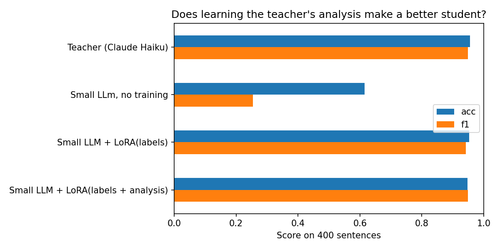

# Distilling Claude into a small finance analyst

I used Claude Haiku as a "teacher" to label 600 financial news sentences and write a
short analysis for each, then fine-tuned Qwen2.5-0.5B-Instruct with LoRA (under 2%
of parameters trained). The result labels sentiment and writes a 2 to 3 sentence
analysis, and runs locally as a Streamlit app with no API calls.

## Results (400 held-out sentences, human labels as ground truth)

| Model | Accuracy | Macro F1 | ms / sentence |
| --- | --- | --- | --- |
| Teacher (Claude Haiku) | 95.5% | 0.949 | 576 |
| Small LLM, no training | 61.5% | 0.254 | 439 |
| + LoRA (labels) | 95.2% | 0.942 | 265 |
| + LoRA (labels + analysis) | 94.8% | 0.949 | 503 |



Fine-tuning took the small model from 61.5% to 95.2% accuracy, within 0.3 points of
the teacher. Training on the analysis didn't change labeling accuracy (the gap is
about 2 sentences out of 400), but it taught the model to explain its calls.

## Run it yourself

```bash
git clone <this repo's URL>
cd llm-distillation-lora
python -m venv .venv
.venv\Scripts\activate        # Mac/Linux: source .venv/bin/activate
pip install -r requirements.txt
streamlit run app.py
```

The trained LoRA adapter is in `lora_analysis/`. The first run downloads the
Qwen2.5-0.5B-Instruct base model (about 1 GB) from Hugging Face.

## How it works

1. **Teacher:** Claude Haiku labels each training sentence (positive, negative or
   neutral) and writes a short investor-focused analysis.
2. **Student:** Qwen2.5-0.5B-Instruct is fine-tuned with LoRA on those outputs,
   once on labels only and once on labels plus analysis.
3. **Evaluation:** every model is graded on the same 400 sentences it never saw,
   against human labels.
4. **Serving:** the analysis adapter is merged into the base model and served in a
   Streamlit app that streams the answer token by token.

## Stack

Python, Anthropic API, Hugging Face transformers, PEFT (LoRA), TRL, Streamlit

Data: Financial PhraseBank (Malo et al., 2014), non-commercial license.